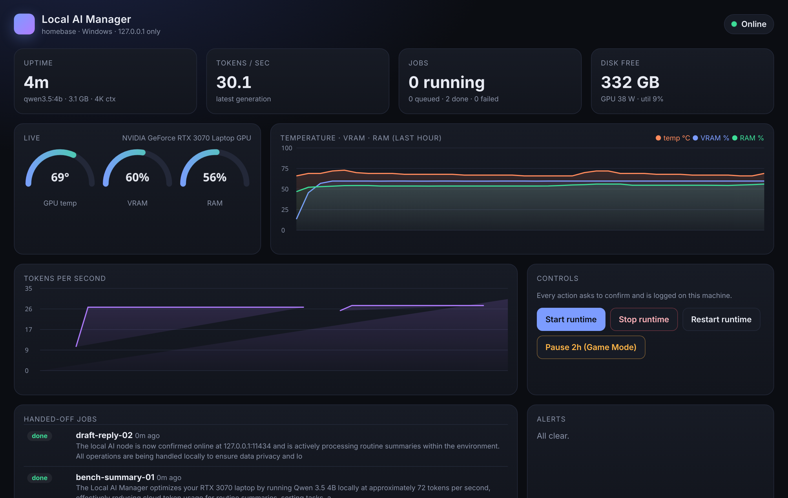
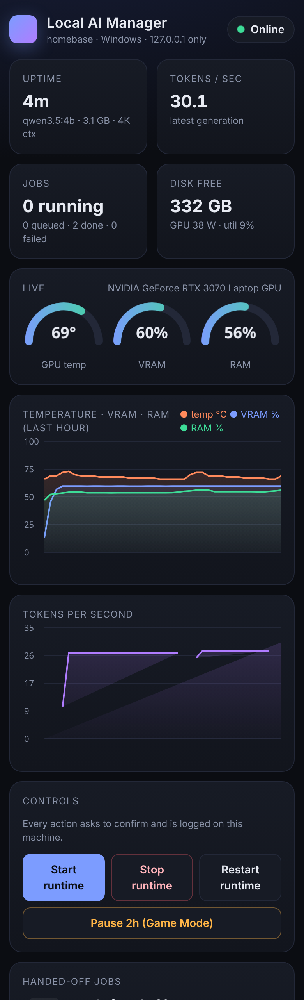

# Local AI Manager

Run your own AI on your own computer, with a Grok Bot that sets it up and keeps it running.



This repo holds the small, auditable scripts the **Local AI Manager** Grok Bot template installs on your machine. The bot downloads a pinned release, checks its SHA-256, and asks before every command.

## What's inside
| File | What it does |
|---|---|
| `src/localai/scan.py` | Read-only hardware scan (GPU, VRAM, RAM, disk, installed runtimes) as JSON |
| `src/localai/worker.py` | Job runner: `~/LocalAI/jobs/inbox → running → done / failed`, calls your local model on 127.0.0.1, enforces your allowed folders, logs token usage |
| `src/localai/watchdog.py` | Runs every 60 s; alerts your bot's webhook when the model is down, overheating, out of VRAM or disk, or a job is stuck |
| `src/localai/dashboard.py` | Private dark dashboard at `http://127.0.0.1:8765` (with 1-click **Pause 2h / Game Mode** to unload VRAM and snooze jobs/alerts), one file, no CDN |
| `installers/` | Register / remove the three as user services (systemd, launchd, Task Scheduler) |



## Safety by design
- Everything binds to `127.0.0.1`. No public ports. Phone access only through `tailscale serve` (tailnet-only), never Funnel.
- Dashboard buttons map to a fixed command allowlist, need a per-run token, and check Host and Origin.
- The worker only reads files inside the folders in `~/LocalAI/containment.json`, fails closed if that file is missing, and never executes model output.
- The watchdog sends plain JSON facts. The bot treats them as data and asks you before any restart.
- No secrets in code: the webhook URL and key live in `~/LocalAI/watchdog.env.json`, readable only by you.
- Standard library only (`psutil` optional).

## Requirements
Python 3.9+, a local runtime (Ollama by default; LM Studio, llama.cpp, vLLM, MLX, and TabbyAPI also work via `LOCAL_AI_URL`), and Linux, macOS, or Windows.

## Quick start
See [INSTALL.md](INSTALL.md). To remove everything, see [UNINSTALL.md](UNINSTALL.md).

## Configuration (env vars)
`LOCAL_AI_URL` (worker endpoint) · `LOCAL_AI_HEALTH` (watchdog probe) · `MODELS_DIR` · `VRAM_LIMIT_PCT` (default 90) · `GPU_TEMP_LIMIT` (default 85) · `LOCALAI_MODEL` (enables Unload) · `LOCALAI_TS_HOST` (tailnet hostname for Tailscale Serve).

## Status
v0.1.0. 21/21 unit tests pass, and the full stack (Ollama + hidden Scheduled Tasks + worker + watchdog + dashboard) is verified live on Windows 11 with an NVIDIA GeForce RTX 3070 Laptop GPU.

## Tests
```
python3 -m pip install pytest && python3 -m pytest -q tests
```

## License
MIT
